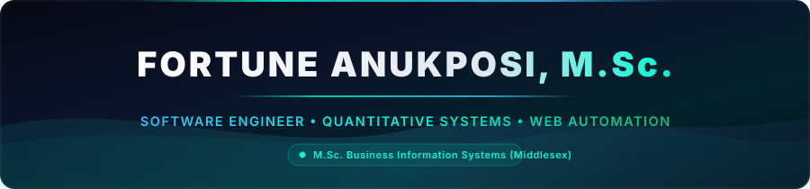

# Fortune Anukposi

**Software Engineer · Quantitative Systems · Data & Automation**

I build tools that turn complex data into useful software: market research workspaces, real-time pipelines, APIs and desktop applications.

[Explore my projects](#selected-projects) · [Get in touch](mailto:fortuneanukposi@gmail.com)

## What I work on

- **Quantitative research:** market-data tools, statistical models, backtesting and research workflows.
- **Backend and data systems:** Python, FastAPI, Node.js, SQL, SQLite and PostgreSQL.
- **Web and desktop applications:** JavaScript, TypeScript, React and Electron.
- **Automation and testing:** browser automation, automated tests, Docker and deployment workflows.

My approach combines practical software development, domain research and careful testing. I use AI-assisted development tools to support implementation and iteration.

## Featured: Quant Terminal

[**Explore Quant Terminal →**](https://github.com/anfor183/quant-terminal)

A local trading workspace for forex, crypto and US stocks, with **88 indicators, up to 16 charts, strategy testing, bar replay and paper trading**. Public data requires no account or API key; Node.js is the only runtime requirement.

This repository is my maintained edition of Lewis Jackson's MIT-licensed Quant Terminal. Original authorship and third-party notices are preserved. Contributions are welcome through forks and pull requests.

## Selected projects

| Project | Focus |
| --- | --- |
| [Quant Terminal](https://github.com/anfor183/quant-terminal) | Local charts, market research, strategy testing and paper trading |
| [Macro Terminal](https://github.com/anfor183/macro-terminal-community) | Macroeconomic research, positioning data and market-bias analysis |
| [Football Prediction](https://github.com/anfor183/football-prediction-community) | Statistical modelling, historical testing and a desktop research dashboard |
| [Nexus VFL](https://github.com/anfor183/bettorvfl-executor-community) | Browser automation, test execution and desktop telemetry |
| [Virtual Football Signals](https://github.com/anfor183/virtualfootballsignals-community) | Real-time data ingestion, WebSocket pipelines and monitoring |
| [TubeOpportunity PRO](https://github.com/anfor183/tube-opportunity-pro) | Keyword research, content opportunity scoring and creator analytics |
| [WhisperTranscribeAI](https://github.com/anfor183/WhisperTranscribeAI) | Local speech-to-text workflows and subtitle export |

## Education

- **M.Sc. Business Information Systems Management, with Merit** — Middlesex University, 2018–2019.
- **B.Sc. (Hons) Information Technology and Business Information Systems, Upper Second-Class Honours** — Middlesex University, 2016–2018.
- **Advanced Diploma in Software Engineering** — Aptech Computer Education, 2014–2016.

## Let's work together

Open to software engineering, backend, full-stack, test automation and data engineering opportunities. Interested in remote roles globally, hybrid work and relocation.

**Contact:** [fortuneanukposi@gmail.com](mailto:fortuneanukposi@gmail.com)

For project questions, ideas or contributions, please use the relevant repository's issues and pull requests.
